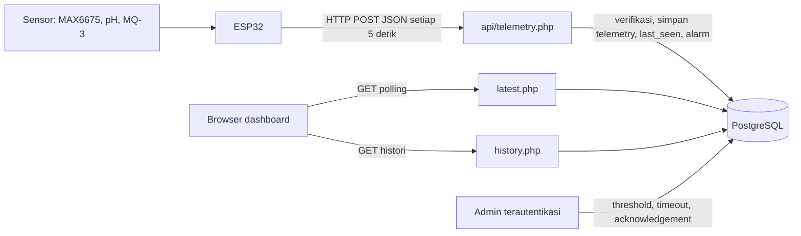

# Classic Enzyme IoT

Sistem pemantauan fermentasi berbasis ESP32 untuk bioreaktor *Classic Enzyme*. Perangkat membaca sensor proses, mengirim telemetri melalui HTTP JSON, lalu aplikasi PHP menyimpan data, mengevaluasi ambang batas, dan menyajikannya melalui dashboard web realtime.

Proyek ini sengaja tidak memakai MQTT, Node.js, Composer, atau proses background. Arsitektur tersebut membuatnya mudah dijalankan pada PHP hosting biasa, cPanel, VPS, maupun laptop pengembangan. *Realtime* dicapai melalui polling browser, bukan WebSocket.

> Status implementasi saat ini: firmware mengaktifkan MAX6675 saja secara bawaan. Pembacaan pH dan MQ-3 sudah didukung oleh kode serta skema database, tetapi dinonaktifkan sampai sensor dan kalibrasinya siap.

## Arsitektur dan aliran data



Siklus satu kiriman telemetri:

1. ESP32 membaca sensor yang aktif dan RSSI Wi-Fi.
2. ESP32 mengirim JSON ke `api/telemetry.php`, membawa `device_id` dan API key.
3. Endpoint menolak device tidak terdaftar atau API key yang tidak cocok, lalu menyimpan satu baris histori jika valid.
4. Endpoint memperbarui `devices.last_seen`, menandai status tersimpan `online`, lalu membandingkan nilai terhadap threshold per device. Pelanggaran membuat baris baru di `alarms`.
5. Dashboard mengambil pembacaan terakhir setiap 3 detik; grafik/tabel histori dimuat ulang setiap 6 detik. Status online yang ditampilkan dihitung dari selisih `last_seen`, sehingga tidak bergantung pada kolom status yang tersimpan.

## Kemampuan yang tersedia

- Dashboard publik untuk suhu, pH, alkohol, RSSI, status koneksi, grafik Chart.js, dan log terakhir. Kartu realtime mengosongkan nilai jika tidak ada telemetri valid dalam 15 detik; data lama tetap tersedia di halaman riwayat.
- Pemilih device; API dan dashboard mendukung banyak device yang terdaftar.
- Riwayat dengan rentang `1h`, `6h`, `24h`, `7d`, atau semua data, statistik min/max/rata-rata, serta ekspor CSV hingga 5.000 baris per device.
- Alarm suhu rendah/tinggi, pH rendah/tinggi, dan alkohol tinggi. Alarm tidak dideduplikasi: setiap pembacaan di luar ambang dapat membuat alarm baru sampai di-*acknowledge*.
- Panel admin berbasis sesi: ubah threshold, timeout offline, *acknowledge* alarm, lihat API key/IP pengirim terakhir, dan ganti password.
- Tema terang/gelap disimpan pada `localStorage`; antarmuka memakai CSS/JS native dan gaya Liquid Glass.

## Struktur proyek

```text
IOT/
├── index.php                         # Dashboard realtime publik
├── history.php                       # Riwayat, statistik, dan ekspor CSV publik
├── login.php / logout.php             # Autentikasi admin berbasis session
├── admin.php                          # Threshold, timeout, alarm, device, akun
├── api/
│   ├── telemetry.php                  # POST ingest dan evaluasi alarm
│   ├── latest.php                     # GET pembacaan/device terkini
│   ├── history.php                    # GET data grafik dan statistik
│   └── devices.php                    # GET daftar device serta status hitung
├── config/
│   ├── database.php                   # PDO PostgreSQL, schema, indeks, settings
│   └── auth.php                       # Session dan proteksi admin
├── firmware/esp32_classic_enzyme/
│   └── esp32_classic_enzyme.ino       # Firmware ESP32
├── components/                        # Partial UI dashboard
├── assets/css/style.css               # Desain responsif Liquid Glass
├── assets/js/app.js                   # Polling, Chart.js, tema, simulasi
└── .htaccess                          # Proteksi Apache untuk config/db dan header dasar
```

## Penyimpanan data

`config/database.php` hanya menggunakan PostgreSQL. Schema dan indeks dapat dibuat sekali saat bootstrap dengan `DB_AUTO_INIT_SCHEMA=true`; setelah produksi stabil, ubah ke `false` agar request web tidak menjalankan DDL berulang. Koneksi PostgreSQL gagal akan menghasilkan error, bukan fallback ke database lain.

| Tabel | Isi |
|---|---|
| `devices` | identitas device, nama/lokasi, API key, dan `last_seen` |
| `telemetry` | setiap pembacaan sensor, RSSI, firmware, IP, waktu device/server |
| `thresholds` | batas min/max per parameter dan per `device_id` |
| `alarms` | pelanggaran threshold dan status acknowledgement |
| `admins` | username dan hash password |
| `settings` | konfigurasi global, saat ini `offline_timeout_seconds` |

Schema PostgreSQL dan seed diinisialisasi oleh fungsi dalam `config/database.php`. Default seed adalah device `esp32-ce-001` dengan placeholder API key yang **wajib diganti sebelum dipakai**, threshold suhu `20–40 °C`, pH `3.0–4.5`, alkohol maksimum `800` ADC, dan timeout offline `300` detik.

## Prasyarat

- PHP 8.x dengan ekstensi `pdo_pgsql`.
- PostgreSQL 14+ dan user database yang memiliki schema `public`.
- Browser dengan JavaScript aktif dan akses internet ke CDN Chart.js (`cdn.jsdelivr.net`) untuk grafik.
- Arduino IDE dengan board ESP32 serta library bawaan `WiFi`, `HTTPClient`, dan `WiFiClientSecure` untuk firmware.

## Menjalankan lokal

Gunakan PostgreSQL lokal atau container PostgreSQL. Contoh setelah database dan user dibuat:

```bash
cd "/Users/favian/Proyek /Classic Enzyme/IOT"
DB_HOST=127.0.0.1 DB_PORT=5432 DB_NAME=classic_enzyme_iot \
DB_USER=classic_enzyme DB_PASS='PASSWORD_DATABASE' \
DB_AUTO_INIT_SCHEMA=true php -S 127.0.0.1:8899
```

Buka <http://127.0.0.1:8899>. Schema PostgreSQL dibuat otomatis saat bootstrap pertama. Untuk mencoba ingest tanpa hardware, gunakan API key device yang sudah diprovision atau:

```bash
NOW=$(date +%s)
curl -X POST http://127.0.0.1:8899/api/telemetry.php \
  -H 'Content-Type: application/json' \
  -H 'X-API-Key: API_KEY_DEVICE_ANDA' \
  -d "{\"device_id\":\"esp32-ce-001\",\"temperature\":35.40,\"ph\":3.82,\"alcohol\":125,\"rssi\":-62,\"firmware\":\"2.0.0\",\"protocol_version\":2,\"ts\":${NOW},\"boot_id\":\"0123456789abcdef0123456789abcdef\",\"sequence\":1}"
```

`api/telemetry.php` hanya menerima API key melalui header `X-API-Key`; key tidak boleh dimasukkan ke JSON body.

## Konfigurasi dan deploy

Gunakan environment variables, bukan mengedit kredensial ke dalam kode:

```bash
DB_HOST=127.0.0.1
DB_PORT=5432
DB_NAME=classic_enzyme_iot
DB_USER=nama_user
DB_PASS=password_rahasia
DB_AUTO_INIT_SCHEMA=false
```

### Panduan Deploy VPS Produksi (Nginx + PHP-FPM + PostgreSQL)

Target URL produksi: `https://puslitkomoditas-strategis.unila.ac.id/iot/`  
Arsitektur: Subpath `/iot/` pada domain kampus yang sudah ada, tanpa mengganggu aplikasi utama di root `/`.

#### 1. Persiapan Database PostgreSQL
PostgreSQL hanya perlu listen di `127.0.0.1` (tidak perlu membuka port 5432 ke publik). Buat database dan role terpisah:

```bash
sudo -u postgres psql
```
Di dalam prompt PostgreSQL:
```sql
CREATE ROLE classic_enzyme LOGIN PASSWORD 'PASSWORD_DATABASE_KUAT';
CREATE DATABASE classic_enzyme_iot OWNER classic_enzyme;
\q
```

#### 2. Penempatan Kode & Hak Akses
Salin isi folder `IOT` ke direktori web server (misalnya `/var/www/iot_classic_enzyme/IOT`):

```bash
sudo mkdir -p /var/www/iot_classic_enzyme
# Salin folder IOT ke /var/www/iot_classic_enzyme/IOT

# Atur kepemilikan dan hak akses:
sudo chown -R www-data:www-data /var/www/iot_classic_enzyme/IOT
sudo find /var/www/iot_classic_enzyme/IOT -type d -exec chmod 755 {} \;
sudo find /var/www/iot_classic_enzyme/IOT -type f -exec chmod 644 {} \;
```

#### 3. Inisialisasi (Bootstrap) Schema Database
Jalankan satu kali script bootstrap schema via PHP CLI menggunakan user `www-data`:

```bash
cd /var/www/iot_classic_enzyme/IOT
sudo -u www-data env \
  DB_HOST=127.0.0.1 DB_PORT=5432 DB_NAME=classic_enzyme_iot \
  DB_USER=classic_enzyme DB_PASS='PASSWORD_DATABASE_KUAT' \
  DB_AUTO_INIT_SCHEMA=true \
  php -r 'require "config/database.php"; getDB(); echo "Schema berhasil dibuat!\n";'
```
*Pastikan tabel `devices`, `telemetry`, `alarms`, `thresholds`, `settings`, `admins`, `security_events`, dan `ingest_rate_limits` terbentuk di PostgreSQL.*

#### 4. Konfigurasi Environment di PHP-FPM
Agar password database aman dan tidak disimpan di web root, masukkan environment variable langsung ke konfigurasi pool PHP-FPM (misal `/etc/php/8.2/fpm/pool.d/www.conf`):

```ini
env[DB_HOST] = 127.0.0.1
env[DB_PORT] = 5432
env[DB_NAME] = classic_enzyme_iot
env[DB_USER] = classic_enzyme
env[DB_PASS] = PASSWORD_DATABASE_KUAT
env[DB_AUTO_INIT_SCHEMA] = false
```

Reload/restart PHP-FPM setelah menyimpan perubahan:
```bash
sudo systemctl restart php8.2-fpm
```

Verifikasi koneksi sebagai `www-data`:
```bash
sudo -u www-data php -r 'require "/var/www/iot_classic_enzyme/IOT/config/database.php"; $db=getDB(); echo "Driver: " . $db->getAttribute(PDO::ATTR_DRIVER_NAME) . "\n";'
```

#### 5. Konfigurasi Nginx untuk Subpath `/iot/`
Tambahkan blok routing berikut ke dalam server block domain kampus yang sudah ada (misal di `/etc/nginx/sites-available/...`):

```nginx
# Routing direktori statis dan web UI Classic Enzyme IoT
location ^~ /iot/ {
    alias /var/www/iot_classic_enzyme/IOT/;
    index index.php;
    try_files $uri $uri/ /iot/index.php?$query_string;

    # Blokir akses langsung ke folder sensitif
    location ^~ /iot/config/ {
        deny all;
        return 404;
    }
}

# Eksekusi PHP untuk subpath /iot/
location ~ ^/iot/(.+\.php)$ {
    alias /var/www/iot_classic_enzyme/IOT/$1;
    include snippets/fastcgi-php.conf;
    fastcgi_param SCRIPT_FILENAME /var/www/iot_classic_enzyme/IOT/$1;
    fastcgi_pass unix:/run/php/php8.2-fpm.sock; # Sesuaikan versi PHP
}
```

Uji dan reload Nginx:
```bash
sudo nginx -t && sudo systemctl reload nginx
```

#### 6. Registrasi Device & Pembuatan API Key
Buat API key yang kuat dan acak menggunakan OpenSSL:

```bash
openssl rand -hex 32
```

Daftarkan/perbarui key untuk device di database PostgreSQL:
```bash
sudo -u postgres psql -d classic_enzyme_iot -c "
UPDATE devices SET api_key = 'HASIL_KEY_RANDOM_DI_ATAS' WHERE device_id = 'esp32-ce-001';
"
```
*(Gunakan key ini juga nanti di file `secrets.h` firmware ESP32).*

#### 7. Pengujian Endpoint Telemetry (Smoke Test)
Sebelum mem-flash firmware fisik, uji penerimaan data menggunakan `curl`:

```bash
NOW=$(date +%s)
curl -i -X POST 'https://puslitkomoditas-strategis.unila.ac.id/iot/api/telemetry.php' \
  -H 'Content-Type: application/json' \
  -H 'X-API-Key: HASIL_KEY_RANDOM_DI_ATAS' \
  -d "{\"device_id\":\"esp32-ce-001\",\"temperature\":35.4,\"rssi\":-60,\"firmware\":\"2.0.0\",\"protocol_version\":2,\"ts\":${NOW},\"boot_id\":\"0123456789abcdef0123456789abcdef\",\"sequence\":1}"
```
*Respons sukses mengembalikan JSON `{"status":"ok",...}` dan data langsung tampil di dashboard `https://puslitkomoditas-strategis.unila.ac.id/iot/`.*

### Data dan Informasi yang Perlu Diambil / Dicatat dari VPS

Sebelum beralih ke laptop/Arduino untuk mem-flash ESP32, berikut data dari VPS yang perlu diambil atau dicatat:

| Data / Info dari VPS | Perintah / Lokasi di VPS | Tujuan / Penggunaan |
|---|---|---|
| **1. Sertifikat Root CA SSL** | `openssl s_client -showcerts -connect puslitkomoditas-strategis.unila.ac.id:443 </dev/null 2>/dev/null \| openssl x509 -outform PEM` | Ditempel ke `secrets.h` (`TLS_ROOT_CA`) ESP32 untuk verifikasi TLS/HTTPS aman. |
| **2. API Key Device** | Hasil generate `openssl rand -hex 32` | Disalin ke `secrets.h` (`API_KEY`) ESP32 agar cocok dengan database server. |
| **3. Path Socket PHP-FPM** | `ls /run/php/php*-fpm.sock` | Untuk memastikan path `fastcgi_pass` di konfigurasi Nginx VPS sesuai (misal `/run/php/php8.2-fpm.sock`). |
| **4. User Web Server** | `ps aux \| grep -E 'nginx\|php-fpm' \| awk '{print $1}' \| sort -u` | Memastikan permission direktori kode (`www-data`). |
| **5. Backup Database Lama** *(opsional)* | `mysqldump -u root -p database_lama > /var/backups/backup_lama.sql` | Disimpan sebelum server beralih penuh ke PostgreSQL. |

#### Cara Ekstrak Root CA untuk ESP32
Jalankan perintah ini di terminal (laptop atau VPS) untuk mendapatkan sertifikat PEM domain:
```bash
openssl s_client -showcerts -connect puslitkomoditas-strategis.unila.ac.id:443 </dev/null 2>/dev/null | openssl x509 -outform PEM
```
Salin blok teks mulai dari `-----BEGIN CERTIFICATE-----` sampai `-----END CERTIFICATE-----` ke konstanta `TLS_ROOT_CA` di `secrets.h`.

---

### Prosedur Update Khusus VPS Percobaan / Pribadi (Secondary Endpoint)

> [!IMPORTANT]
> **Pahami Konteks Dual-Server Sistem Ini:**
> 1. **Server 1 — Utama Produksi Kampus (`puslitkomoditas-strategis.unila.ac.id/iot/`)**:  
>    Server ini adalah lingkungan produksi kampus yang **TIDAK diotak-atik** pada tahap ini. Firmware ESP32 v2.2.0 dirancang **100% backward compatible** — field tambahan `alcohol_ppm` pada JSON payload tidak akan merusak atau menyebabkan error pada Server 1.
> 2. **Server 2 — VPS Percobaan / Server Pribadi (`https://3.25.243.43:8443`)**:  
>    Server ini dikontrol penuh oleh Anda sebagai lingkungan uji bebas. **Seluruh prosedur update backend, migrasi PostgreSQL, dan pengujian dashboard di bawah ini ditujukan KHUSUS untuk Server 2 ini.**

---

#### 1. Berkas yang Diperbarui di VPS Percobaan
Salin/sinkronkan berkas-berkas berikut ke direktori web server di VPS percobaan Anda (misal `/var/www/iot/`):
- `config/database.php` (skema auto-migrasi kolom `alcohol_ppm` & ambang batas default)
- `api/telemetry.php` (ekstraksi `alcohol_ppm`, validasi fisik, dan penyimpanan ke DB)
- `api/latest.php` (menampilkan `alcohol_ppm` di JSON endpoint realtime)
- `api/history.php` (menampilkan `alcohol_ppm` dan statistik min/max/avg ppm)
- `components/metric_cards.php` (elemen tampilan ppm pada kartu dashboard)
- `assets/js/app.js` (binding data realtime dan tampilan ppm di tabel/kartu)
- `history.php` (kolom ppm di ekspor CSV, tabel riwayat, dan mobile card)

#### 2. Cara Unggah / Sinkronkan Berkas ke VPS Percobaan
Dari terminal laptop Anda:

```bash
cd "/Users/favian/Proyek /Classic Enzyme"

# Jika menggunakan rsync ke VPS percobaan (IP 3.25.243.43 atau host Anda):
rsync -avz --exclude 'secrets.h' --exclude '.git' \
  IOT/ user_vps@3.25.243.43:/var/www/iot/

# Atau jika VPS percobaan Anda menggunakan Git:
# Di terminal VPS percobaan:
# cd /var/www/iot && git pull origin main
```

Pastikan kepemilikan berkas di VPS tetap milik user web server (`www-data`):
```bash
sudo chown -R www-data:www-data /var/www/iot
```

#### 3. Migrasi Skema & Data di PostgreSQL VPS Percobaan

1. **Auto-Migrasi Skema (Zero Downtime)**:  
   Fungsi `ensureSecuritySchema()` di `config/database.php` akan **otomatis menambahkan kolom `alcohol_ppm NUMERIC(8,2) NULL`** ke tabel `telemetry` di VPS percobaan saat pertama kali web dibuka atau ada request masuk.

2. **Migrasi Data Historis di VPS Percobaan (Retroaktif)**:  
   Agar data rekaman lama yang ada di database VPS percobaan memiliki nilai ppm, masuk ke PostgreSQL VPS:
   
   ```bash
   sudo -u postgres psql -d classic_enzyme_iot
   ```
   Eksekusi query kalkulasi:
   ```sql
   UPDATE telemetry
   SET alcohol_ppm = ROUND(
       (0.3934 * POWER(CAST(raw_adc AS FLOAT) / 160.0, -1.504))::NUMERIC, 
       2
   )
   WHERE raw_adc IS NOT NULL
     AND raw_adc > 0
     AND raw_adc <= 4095
     AND (CAST(raw_adc AS FLOAT) / 160.0) >= 0.1
     AND alcohol_ppm IS NULL
     AND received_at >= '2026-10-24 12:00:00';
   ```

   Cek hasil pembaruan:
   ```sql
   SELECT id, received_at, raw_adc, alcohol_ppm FROM telemetry ORDER BY id DESC LIMIT 5;
   \q
   ```

#### 4. Reload Service di VPS Percobaan
```bash
sudo systemctl restart php8.2-fpm   # sesuaikan versi PHP jika 8.1 / 8.3
sudo systemctl reload nginx         # atau apache2 (sesuai webserver VPS port 8443)
```

#### 5. Uji Coba Endpoint API di VPS Percobaan
Jalankan pengujian langsung ke endpoint VPS percobaan (port 8443):
```bash
# Uji dari terminal (gunakan -k jika memakai self-signed cert di VPS test)
curl -k -s "https://3.25.243.43:8443/api/latest.php?device_id=esp32-ce-001" | jq .telemetry
```
Periksa apakah properti `"alcohol_ppm"` sudah muncul dalam respons JSON:
```json
{
  "id": 1247,
  "temperature": 32.5,
  "ph": null,
  "alcohol": 2450.0,
  "alcohol_ppm": 0.06,
  ...
}
```
Buka dashboard VPS percobaan Anda di browser: `https://3.25.243.43:8443/` untuk memastikan tampilan nilai ppm di kartu sensor dan tabel riwayat berfungsi dengan benar.

---

## Firmware ESP32

Salin `firmware/esp32_classic_enzyme/secrets.example.h` menjadi `secrets.h`, lalu isi konfigurasi yang telah diambil dari langkah deploy VPS di atas sebelum firmware di-flash. File `secrets.h` diabaikan Git dan ESP32 tetap konek/reconnect Wi-Fi otomatis saat boot:

```cpp
constexpr char WIFI_SSID[] = "NAMA_WIFI";
constexpr char WIFI_PASSWORD[] = "PASSWORD_WIFI";
constexpr char SERVER_URL[] = "https://puslitkomoditas-strategis.unila.ac.id/iot/api/telemetry.php";
constexpr char DEVICE_ID[] = "esp32-ce-001";
constexpr char API_KEY[] = "HASIL_KEY_RANDOM_DARI_VPS";

// Sertifikat Root CA yang diekstrak dari server utama (jangan gunakan setInsecure)
constexpr char TLS_ROOT_CA[] = R"PEM(
-----BEGIN CERTIFICATE-----
MIIFazCCA1OgAwIBAgIRAIIQz7DSQONZRGPgu2OCiwAwDQYJKoZIhvcNAQELBQAw
... (tempel seluruh isi sertifikat PEM domain di sini) ...
-----END CERTIFICATE-----
)PEM";

// ─── Dual Endpoint (API Pihak Ketiga) ───────────────────────────────────────
// Set true untuk mengaktifkan pengiriman paralel/independen ke endpoint kedua
constexpr bool SECONDARY_ENDPOINT_ENABLED = false;

constexpr char SERVER_URL_2[]     = "https://api.pihak-ketiga.example/v1/telemetry";
constexpr char API_KEY_2[]        = "TOKEN_DARI_PIHAK_KETIGA";
constexpr char API_KEY_HEADER_2[] = "Authorization";
constexpr char API_KEY_PREFIX_2[] = "Bearer ";

constexpr char TLS_ROOT_CA_2[] = R"PEM(
-----BEGIN CERTIFICATE-----
TEMPEL_CA_PENERBIT_SERTIFIKAT_API_PIHAK_KETIGA
-----END CERTIFICATE-----
)PEM";
```

| Sensor | Pin ESP32 | Catatan |
|---|---:|---|
| MAX6675 / termokopel K | SCK 18, SO 19, CS 5 | suhu, diaktifkan bawaan |
| MQ-3 analog | GPIO 34 | alkohol; input-only |
| pH analog | GPIO 35 | pH; input-only |
| LED bawaan | GPIO 2 | menyala ketika proses kirim |

Aktifkan sensor hanya setelah terpasang dengan mengubah `SENSOR_*_TERPASANG` menjadi `true`. Sensor nonaktif atau pembacaan MAX6675 invalid dikirim sebagai `null`, dan `null` tidak memicu alarm parameter tersebut. Pembacaan pH memakai kalibrasi linear (`PH_7_VOLTAGE` dan `PH_SLOPE`) yang harus dikalibrasi terhadap probe Anda. Nilai MQ-3 dikonversi menjadi `alcohol_ppm` pada firmware v2.2.0 menggunakan kurva daya etanol Hanwei ($R_0 = 160.0$, kurva log) dan dikirim bersamaan dengan raw ADC untuk kompatibilitas penuh.

Firmware mengirim setiap interval (`SEND_INTERVAL_MS`, default 5 menit) dan mencoba menyambung ulang Wi-Fi sebelum pengiriman. Sebelum telemetri dikirim, firmware menyinkronkan waktu NTP, memverifikasi sertifikat HTTPS dengan `TLS_ROOT_CA`, lalu mengirim timestamp Unix serta `boot_id`/`sequence` untuk anti-replay.

### Fitur Dual Endpoint Telemetry

Firmware mendukung pengiriman satu sampel sensor ke dua endpoint sekaligus secara independen:
1. **Primary Endpoint (`SERVER_URL`)**: Mengirim payload v2 standar ke backend Classic Enzyme.
2. **Secondary Endpoint (`SERVER_URL_2`)**: Mengirim payload yang telah disesuaikan melalui fungsi adapter `buildSecondaryPayload()`.

**Karakteristik Operasional:**
- **Sequential Execution**: Pengiriman dilakukan berurutan (Primary lalu Secondary). Hanya ada **1 client TLS aktif pada satu waktu**, menjaga penggunaan RAM ESP32 tetap aman dan mencegah heap fragmentation.
- **Failure Isolation**: Kegagalan pada secondary (misal timeout, 4xx, 5xx) **tidak membatalkan atau mengulang primary**. Begitu pula kegagalan primary tidak membatalkan secondary selama Wi-Fi dan waktu masih valid.
- **Keamanan Ketat**: Kedua endpoint wajib HTTPS dengan validasi root CA terpisah (`TLS_ROOT_CA` dan `TLS_ROOT_CA_2`). Tidak ada `setInsecure()`, dan token tidak dicatat ke log Serial.
- **Konfigurasi On/Off**: Cukup atur `SECONDARY_ENDPOINT_ENABLED = false` jika ingin menjalankan firmware hanya untuk backend utama.

Payload v2 primary:

```json
{
  "device_id": "esp32-ce-001",
  "temperature": 34.75,
  "ph": null,
  "alcohol": 2450,
  "alcohol_ppm": 0.06,
  "raw_temp": 34.75,
  "raw_adc": 2450,
  "rssi": -64,
  "firmware": "2.2.0",
  "protocol_version": 2,
  "ts": 1760000000,
  "boot_id": "0123456789abcdef0123456789abcdef",
  "sequence": 42
}
```

Endpoint mengizinkan `POST` dan preflight `OPTIONS`; respons sukses berisi `status`, `telemetry_id`, `server_time`, dan `alarms_count`.

## Kontrak API ringkas

| Endpoint | Akses | Fungsi |
|---|---|---|
| `POST /api/telemetry.php` | device + API key | ingest satu pembacaan |
| `GET /api/latest.php?device_id=…` | publik | nilai terakhir, threshold, status online, jumlah alarm aktif |
| `GET /api/history.php?device_id=…&range=1h&limit=60&order=asc` | publik | histori (limit 10–10.000) dan statistik |
| `GET /api/devices.php` | publik | daftar device serta pembacaan terakhir |

Rentang API history: `1h`, `6h`, `24h`, `7d`, atau `all`; `order` hanya `asc` atau `desc`. `latest.php` menyembunyikan `ip_address` kecuali sesi admin aktif. Halaman `history.php?action=export_csv` juga hanya menambahkan kolom IP kepada admin.

## Admin dan keamanan operasional

Masuk melalui `/login.php` dengan seed awal `admin` / `password`, lalu segera ganti password. Menu admin mendukung perubahan timeout offline (minimal 30 detik), threshold, dan acknowledgement alarm. Implementasi antarmuka threshold saat ini dipatok ke `esp32-ce-001`, meskipun skema dan endpoint mendukung threshold per device; untuk device tambahan, masukkan record `devices` dan `thresholds` melalui database sampai UI multi-device admin ditambahkan.

Sebelum produksi:

- Ganti API key placeholder dan password admin. API key hanya dikirim pada header `X-API-Key`, disimpan sebagai hash setelah autentikasi pertama, dan tidak ditampilkan ulang di panel admin.
- Gunakan HTTPS dengan CA penerbit sertifikat yang benar pada `TLS_ROOT_CA`; firmware tidak lagi menerima URL HTTP atau memakai `setInsecure()`.
- Batasi asal akses endpoint/API dengan firewall atau jaringan privat bila memungkinkan. Endpoint API memakai `Access-Control-Allow-Origin: *` dan belum menerapkan rate limiting.
- Pastikan `.htaccess` aktif atau buat aturan Nginx ekuivalen, dan jangan simpan kredensial di web root tanpa proteksi.
- Cadangkan tabel `telemetry`; tidak ada retensi, agregasi, maupun pembersihan otomatis.

## Batasan yang perlu dipahami

- Alarm dicatat pada setiap sampel out-of-range dan tidak otomatis kembali normal/tertutup.
- Status offline adalah hasil hitung dari `last_seen` dan `offline_timeout_seconds`; sistem tidak membuat alarm khusus ketika device kemudian menjadi offline.
- Dashboard publik dan endpoint GET tidak memerlukan login. API key melindungi ingest, bukan pembacaan data.
- Kode firmware memakai `WiFiClientSecure` bahkan jika `SERVER_URL` masih `http://`; gunakan URL HTTPS dalam deployment atau sesuaikan klien HTTP secara eksplisit.
- Migrasi dari MySQL lama harus dilakukan sebagai proses ETL/pgloader terpisah; runtime aplikasi ini tidak menyediakan fallback atau koneksi MySQL.
