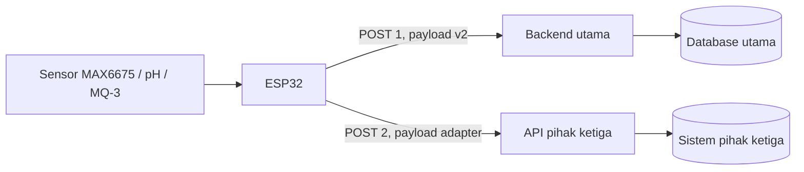

# Rencana Implementasi Dual Endpoint Telemetry ESP32

Status: diimplementasikan pada firmware v2.2.0; pengujian lapangan dilakukan bertahap  
Tanggal: 2026-10-23 (diperbarui 2026-10-29)  
Cakupan: ESP32 mengirim satu sampel telemetri ke **dua tujuan keluar**:

1. Backend utama Classic Enzyme (`SERVER_URL`).
2. API pihak ketiga dengan kontrak yang tidak dapat diubah (`SERVER_URL_2`).

Dokumen ini **bukan** untuk sinkronisasi dua arah antar-server. Kedua tujuan hanya menerima data dari ESP32.

## 1. Ringkasan keputusan

- Pengiriman dilakukan **berurutan**, bukan bersamaan: primary selesai, lalu secondary.
- Satu sampel sensor dibaca sekali, lalu dipakai untuk kedua payload.
- `boot_id` dan `sequence` dibuat sekali per sampel dan dipakai di kedua tujuan.
- Primary tetap memakai payload v2 yang sekarang. Secondary memakai adapter payload sesuai kontrak pihak ketiga.
- Kegagalan secondary tidak boleh membatalkan/mengulang primary. Sebaliknya, kegagalan primary tidak otomatis membatalkan secondary selama Wi-Fi dan waktu masih valid.
- Tidak ada antrean persisten pada fase ini. Jika salah satu tujuan down, sampel tersebut hilang untuk tujuan itu dan akan dicoba lagi pada interval berikutnya.
- Kedua endpoint wajib HTTPS dengan CA yang divalidasi. Tidak ada `setInsecure()`.
- `secrets.h` tetap diabaikan Git.

## 2. Tujuan dan non-tujuan

### Tujuan

- Menambah dukungan endpoint kedua tanpa mengubah perilaku backend utama.
- Menjaga konsumsi RAM ESP32 tetap aman dengan hanya satu koneksi TLS aktif pada satu waktu.
- Memisahkan status keberhasilan/kegagalan per endpoint di log serial.
- Menyediakan jalur adapter untuk perbedaan format payload, header autentikasi, dan kode respons pihak ketiga.
- Menjaga kompatibilitas payload v2 dan anti-replay yang sudah ada.

### Non-tujuan

- Sinkronisasi dua arah atau mirror antar-server.
- Antrean offline persisten di flash.
- Retry berkali-kali dalam satu siklus.
- Perubahan pada `api/telemetry.php` atau skema database.
- Dukungan MQTT/WebSocket.
- Menjamin exactly-once delivery ke pihak ketiga.

## 3. Arsitektur



Alur per siklus:

1. Baca semua sensor sekali.
2. Validasi rentang transport sekali.
3. Sinkronkan waktu sekali.
4. Naikkan `telemetrySequence` sekali.
5. Kirim ke primary dan catat hasilnya.
6. Jika secondary aktif, kirim ke secondary dan catat hasilnya.
7. Matikan LED setelah kedua percobaan selesai.

## 4. Perubahan konfigurasi

File: `firmware/esp32_classic_enzyme/secrets.example.h`

Tambahkan konfigurasi berikut. Nilai nyata hanya diisi di `secrets.h`.

```cpp
constexpr bool SECONDARY_ENDPOINT_ENABLED = false;

constexpr char SERVER_URL_2[] = "https://api.pihak-ketiga.example/v1/telemetry";
constexpr char API_KEY_2[] = "TOKEN_DARI_PIHAK_KETIGA";
constexpr char API_KEY_HEADER_2[] = "Authorization";
constexpr char API_KEY_PREFIX_2[] = "Bearer ";

constexpr char TLS_ROOT_CA_2[] = R"PEM(
-----BEGIN CERTIFICATE-----
TEMPEL_CA_PENERBIT_SERTIFIKAT_API_PIHAK_KETIGA
-----END CERTIFICATE-----
)PEM";
```

Catatan:

- `SECONDARY_ENDPOINT_ENABLED=false` membuat firmware berperilaku sama seperti sekarang.
- `API_KEY_HEADER_2` dan `API_KEY_PREFIX_2` harus mengikuti kontrak pihak ketiga. Jika API memakai query parameter atau signature HMAC, adapter perlu ditambah secara khusus.
- Jika pihak ketiga memakai mTLS/client certificate, konfigurasi tambahan dan pengujian terpisah diperlukan.
- Jangan menaruh token di body JSON atau log serial.

Perbarui juga dokumentasi di `README.md` pada bagian konfigurasi firmware.

## 5. Perubahan firmware

File utama: `firmware/esp32_classic_enzyme/esp32_classic_enzyme.ino`

### 5.1 Struktur data

Tambahkan struktur agar payload dan endpoint tidak tercampur:

- `TelemetrySample`: temperature, ph, alcohol, rssi, timestamp, sequence, bootId.
- `EndpointConfig`: name, url, apiKey, apiKeyHeader, apiKeyPrefix, caCert, enabled.
- Dua instance konfigurasi: primary dan secondary.

Tujuan pemisahan ini adalah agar fungsi pengiriman tidak lagi bergantung pada global `SERVER_URL` dan `API_KEY` saja.

### 5.2 Refactor validasi dan payload

Pisahkan bagian berikut dari `sendTelemetryData()`:

- Validasi rentang suhu, pH, dan ADC.
- Pembentukan string `null` untuk sensor yang mati.
- Pembuatan payload v2 primary.

Fungsi baru yang disarankan:

```cpp
bool buildPrimaryPayload(const TelemetrySample& sample, char* out, size_t outSize);
bool buildSecondaryPayload(const TelemetrySample& sample, char* out, size_t outSize);
bool sendToEndpoint(const EndpointConfig& endpoint, const char* payload);
```

`buildSecondaryPayload()` adalah titik adapter. Isi field mengikuti kontrak pihak ketiga, bukan memaksa payload v2.

### 5.3 Pengiriman per endpoint

`sendToEndpoint()` bertanggung jawab untuk:

- Mengecek `enabled`, URL tidak kosong, dan skema HTTPS.
- Memastikan CA tersedia.
- Membuat `WiFiClientSecure` di dalam fungsi agar hanya satu client TLS hidup pada satu waktu.
- Memasang CA dengan `setCACert()`.
- Memasang `Content-Type: application/json`.
- Memasang header autentikasi sesuai `apiKeyHeader` dan `apiKeyPrefix`.
- Mengatur timeout 4000 ms.
- Memanggil `POST` dan menerima semua kode 2xx sebagai sukses.
- Mencatat kode HTTP, durasi, dan pesan error tanpa mencetak API key.
- Memanggil `http.end()` dan `client.stop()` sebelum kembali.

Yang harus dihindari:

- Dua `WiFiClientSecure` global yang hidup bersamaan.
- Memakai ulang `HTTPClient` yang sudah di-`end()` untuk host berbeda tanpa pengujian.
- Membaca seluruh response body tanpa batas jika pihak ketiga bisa mengirim response besar.
- Membuat `String` payload baru per endpoint jika ukuran tetap bisa memakai buffer.

### 5.4 Perubahan `sendTelemetryData()`

Urutan baru:

1. Cek Wi-Fi; reconnect sekali bila perlu.
2. Jika Wi-Fi tetap terputus, keluar.
3. Sinkronkan waktu sekali. Jika gagal, keluar.
4. Validasi sampel sekali.
5. Buat `TelemetrySample` dan naikkan `telemetrySequence` sekali.
6. Bangun payload primary, kirim ke primary.
7. Jika `SECONDARY_ENDPOINT_ENABLED`, bangun payload secondary dan kirim.
8. Log ringkasan: `primary=OK/FAIL secondary=OK/FAIL/SKIP`.
9. Matikan LED.

Kebijakan kegagalan:

- Primary gagal karena 4xx/5xx/timeout: secondary tetap dicoba.
- Primary gagal karena Wi-Fi putus: coba reconnect sekali, lalu lanjut ke secondary jika tersambung.
- Secondary gagal: tidak memengaruhi primary dan tidak memicu retry primary.
- NTP gagal: kedua endpoint dilewati, sama seperti perilaku sekarang.
- URL secondary bukan HTTPS: secondary dilewati dengan log error, primary tetap jalan.

### 5.5 Timing dan watchdog

- Timeout per endpoint: 4000 ms.
- Worst case satu siklus: sekitar 8 detik ditambah waktu sensor dan handshake.
- Interval kirim tetap 5 menit.
- Ukur durasi tiap endpoint dengan `millis()` dan log nilainya.
- Jika total blocking dianggap terlalu lama, turunkan timeout secondary menjadi 2500–3000 ms setelah pengukuran, bukan langsung mengubah timeout primary.

### 5.6 Memori

- Hanya satu TLS handshake aktif pada satu waktu.
- Buffer payload primary tetap memakai ukuran yang sekarang.
- Buffer secondary disesuaikan dengan kontrak, usahakan tetap di bawah 1 KB.
- Log `ESP.getFreeHeap()` dan `ESP.getMinFreeHeap()` selama pengujian, bukan di setiap siklus produksi.
- Jika pihak ketiga membutuhkan payload besar atau response besar, pertimbangkan stream parsing, bukan menambah buffer statis.

## 6. Adapter API pihak ketiga

Sebelum implementasi, kumpulkan kontrak berikut:

| Item | Yang perlu dipastikan |
|---|---|
| URL | Path, versi API, apakah ada trailing slash |
| Metode | Hampir pasti POST, tetapi pastikan |
| Autentikasi | Nama header, prefix, token, apakah token kedaluwarsa |
| Payload | Nama field, tipe, satuan, field wajib/opsional |
| Waktu | Unix timestamp, ISO-8601, atau format lain; zona waktu |
| Sensor opsional | Kirim `null`, `0`, atau omit saat sensor mati |
| Identitas | Apakah `device_id` dan `boot_id` boleh dikirim |
| Sukses | Kode 200/201/202/204 yang dianggap sukses |
| Error | Format error dan apakah ada `Retry-After` |
| Rate limit | Batas request per menit/hari |
| TLS | CA penerbit, SNI, apakah memakai mTLS |
| Retensi | Berapa lama data disimpan pihak ketiga |
| Legal | Izin berbagi data dan identitas perangkat |

Contoh tabel mapping yang harus diisi dari kontrak nyata:

| Sumber ESP32 | Field secondary | Transformasi |
|---|---|---|
| `temperature` | `temperature_c` | `null` jika sensor mati |
| `ph` | `ph` | `null` jika sensor mati |
| `alcohol` | `alcohol_adc` | ADC mentah, bukan ppm |
| `rssi` | `signal_dbm` | bilangan negatif |
| `ts` | `timestamp` | sesuaikan format |
| `bootId` + `sequence` | `idempotency_key` | misalnya `bootId-sequence` |

Jika API pihak ketiga memakai tanda tangan HMAC, nonce, atau OAuth, buat fungsi adapter terpisah. Jangan menambahkan logika kripto ke `sendToEndpoint()` agar fungsi transport tetap sederhana.

## 7. Keamanan

- Token secondary disimpan hanya di `secrets.h` yang sudah masuk `.gitignore`.
- Gunakan token khusus device, bukan token admin pihak ketiga.
- Jangan mencetak header autentikasi ke serial.
- Jangan mencetak response body secara penuh jika mengandung token/data pribadi.
- Validasi CA untuk kedua endpoint; jangan memakai `setInsecure()`.
- Pastikan server waktu dan sertifikat valid. Kesalahan jam dapat membuat TLS gagal.
- Tinjau ulang izin berbagi data sensor dan `device_id` dengan pihak ketiga.

## 8. Rencana pengujian

### 8.1 Build

- Build dengan board ESP32 Dev Module.
- Pastikan build berhasil dengan `SECONDARY_ENDPOINT_ENABLED=false` dan `true`.
- Pastikan tidak ada peringatan baru terkait buffer overflow atau tipe data.

### 8.2 Regression primary

- Payload primary harus tetap sesuai format v2.
- Urutan field, tipe data, dan nilai `null` tidak berubah.
- Backend utama tetap menerima data dan mengevaluasi alarm seperti sebelumnya.
- Saat secondary dimatikan, perilaku dan timing mendekati firmware lama.

### 8.3 Mock secondary

- Siapkan endpoint HTTPS lokal atau staging dengan CA uji.
- Verifikasi header autentikasi, payload, dan jumlah request.
- Uji respons 200, 201, 202, 204, 400, 401, 429, 500, dan timeout.
- Pastikan primary tetap sukses saat secondary mengembalikan error.

### 8.4 Negative test

- URL secondary bukan HTTPS.
- CA secondary salah.
- Token secondary salah.
- Secondary down/timeout.
- Primary down, secondary hidup.
- Wi-Fi putus sebelum siklus.
- Wi-Fi putus di tengah pengiriman primary.
- NTP gagal.
- Sensor suhu/pH/alkohol mati atau menghasilkan `NAN`.

### 8.5 Soak test

- Jalankan minimal 30 siklus dengan kedua endpoint aktif.
- Catat `ESP.getFreeHeap()` sebelum dan sesudah; tidak boleh ada tren penurunan besar.
- Catat durasi primary dan secondary.
- Pastikan tidak ada reset/watchdog.
- Uji minimal 24 jam untuk melihat kebocoran memori dan stabilitas koneksi.

### 8.6 Kriteria lulus

- Kedua endpoint menerima satu sampel per interval saat keduanya sehat.
- Primary tetap berfungsi penuh jika secondary gagal.
- Tidak ada API key di log, repository, atau payload.
- Tidak ada penurunan heap yang signifikan setelah 30 siklus.
- Waktu kirim total masih wajar dan tidak menggeser interval 5 menit secara berarti.
- Build bersih dan dokumentasi diperbarui.

## 9. Rollout

1. Kumpulkan kontrak API pihak ketiga dan isi tabel mapping.
2. Tambahkan konfigurasi secondary ke `secrets.example.h` dan `README.md`.
3. Refactor firmware dengan secondary nonaktif; uji regresi primary.
4. Aktifkan secondary di perangkat uji/staging.
5. Pantau log serial minimal 24 jam untuk memastikan tidak ada reset, timeout berlebihan, atau kebocoran heap.
6. Aktifkan di satu perangkat produksi.
7. Setelah stabil, aktifkan di perangkat lain dan perbarui dokumentasi operasional.

## 10. Checklist implementasi

- [ ] Kontrak API pihak ketiga terdokumentasi.
- [ ] Mapping payload final.
- [x] `secrets.example.h` diperbarui.
- [x] `README.md` diperbarui.
- [x] Struktur `TelemetrySample` dan `EndpointConfig` ditambahkan.
- [x] Payload primary dipisahkan tanpa mengubah format.
- [x] Adapter payload secondary dibuat.
- [x] `sendToEndpoint()` dibuat dengan TLS per endpoint.
- [x] Pengiriman berurutan dan independen diimplementasikan.
- [x] Log per endpoint ditambahkan tanpa membocorkan token.
- [x] Penanganan 2xx dan error response diuji.
- [ ] Regression test primary lulus.
- [ ] Negative test lulus.
- [ ] Soak test heap dan timing lulus.
- [ ] Rollout satu perangkat selesai.

## 11. Risiko dan mitigasi

| Risiko | Dampak | Mitigasi |
|---|---|---|
| Skema pihak ketiga berubah | Payload ditolak | Adapter terisolasi, versi API dicatat, monitoring error |
| TLS handshake lambat | Siklus memblokir lebih lama | Timeout per endpoint, ukur durasi, pertimbangkan 2500 ms untuk secondary |
| Memori tidak cukup/fragmentasi | Reset atau gagal koneksi | Satu client TLS aktif, ukur heap, hindari String dinamis |
| Tidak ada antrean | Data hilang saat endpoint down | Terima sebagai batasan fase ini; pertimbangkan LittleFS queue bila perlu |
| Rate limit pihak ketiga | Request ditolak | Hormati batas, jangan retry agresif, log `429` dan `Retry-After` |
| Token secondary bocor | Akses tidak sah | `secrets.h`, jangan log header, rotasi token |
| Sertifikat CA kedaluwarsa | Secondary berhenti | Monitoring masa berlaku sertifikat |
| Perbedaan waktu | Timestamp ditolak | Sinkronisasi NTP sebelum kirim, cek format waktu kontrak |
| Duplikat saat retry manual | Data ganda di pihak ketiga | Gunakan idempotency key bila didukung |

## 12. Pertanyaan yang harus dijawab sebelum coding

1. Apa URL, metode, dan header autentikasi API pihak ketiga?
2. Apakah payload harus sama dengan v2 atau punya skema sendiri?
3. Format timestamp dan satuan yang diminta?
4. Apakah `null` diterima untuk sensor yang belum dipasang?
5. Kode respons apa yang dianggap sukses?
6. Apakah ada rate limit atau kuota harian?
7. Apakah API memakai mTLS atau signature khusus?
8. Apakah kegagalan sesekali dapat diterima, atau perlu antrean persisten?
9. Apakah data dan `device_id` boleh dibagikan ke pihak ketiga?
10. Siapa yang memantau error pengiriman secondary?
